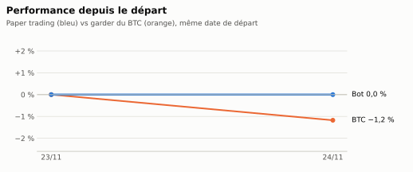
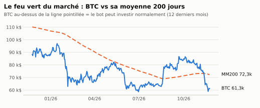
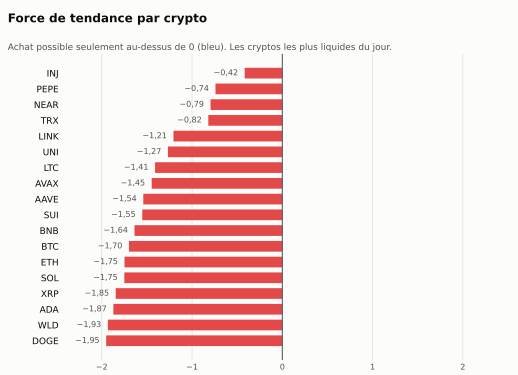

# Bot crypto : trend-following multi-actifs (paper trading)

<!-- DASHBOARD:START -->
## 📊 Suivi du paper trading

**🔴 Page en direct : https://samuelnajman-prog.github.io/botcrypto/**

*Mis à jour automatiquement le 24/11/2026 à 17:09 UTC. Jour 1 du test, argent fictif. Le bot décide toutes les 4 h, à chaque fois sur 1/6 du capital (6 tranches).*

| Valeur | Depuis le départ | BTC, même période | Repli actuel | Investi |
|:---:|:---:|:---:|:---:|:---:|
| **10 000 $** | **0,0 %** | −2,3 % | 0,0 % | 0 % |

🔴 **Marché baissier (risk-off)** : BTC à 61 271 $, −15,2 % sous sa moyenne 200 jours (72 291 $). Le bot n'investit que sur BTC/ETH, 35 % maximum, et seulement s'ils sont en tendance haussière. Cryptos en tendance haussière aujourd'hui : **0 sur 18**.

<picture><source media="(prefers-color-scheme: dark)" srcset="docs/img/perf-dark.svg"></picture>

<picture><source media="(prefers-color-scheme: dark)" srcset="docs/img/regime-dark.svg"></picture>

<details>
<summary><b>Force de tendance de chaque crypto</b> (achat possible si &gt; 0)</summary>

<picture><source media="(prefers-color-scheme: dark)" srcset="docs/img/signals-dark.svg"></picture>

</details>

### Positions
Aucune : 100 % en stablecoin (USDT).

### Derniers ordres
Aucun ordre pour l'instant.

### Seuils d'alerte
| Indicateur | Actuel | Normal | Alerte |
|---|---:|---:|---:|
| ✅ Pire repli depuis le départ | 0,0 % | > −25 % | < −40 % |
| ✅ Heures depuis la dernière exécution | 0,0 h | < 5 h | > 8 h |
| ✅ Nombre d'ordres | 0 | — | — |

Repères du backtest (2018-2026) sur 6 mois : médiane +4 %, 5 % pires cas −16 %, 5 % meilleurs cas +136 %.
<!-- DASHBOARD:END -->

Bot de trading systématique sur les cryptos du spot Binance : il suit les tendances, ne va jamais à découvert, n'utilise pas de levier et repasse en stablecoin quand le marché est baissier. **Il n'utilise pas d'argent réel** : aucun module d'exécution réelle n'est branché, et aucune clé API n'est nécessaire.

La stratégie complète et ses justifications sont dans [`STRATEGIE.md`](STRATEGIE.md).

## Installation

```bash
python3 -m venv .venv && source .venv/bin/activate
pip install -r requirements.txt
python main.py fetch          # télécharge l'historique journalier de ~50 cryptos (2-5 min la 1re fois)
python -m pytest -q tests     # 6 tests, dont l'absence de biais d'anticipation
```

## Commandes

| Commande | Rôle |
|---|---|
| `python main.py backtest` | Backtest 2018-06 → aujourd'hui vs BTC buy & hold |
| `python main.py signals` | Régime de marché, forecasts et poids cibles du jour |
| `python main.py paper run` | Une exécution de paper trading : chaque tranche dont la « journée » vient de se clôturer décide (idempotent) |
| `python main.py paper status` | Valorisation live du portefeuille paper |
| `python main.py paper reset --capital 10000` | Repart de zéro |
| `python main.py paper loop` | Tourne en continu, exécution chaque jour à 00:10 UTC |
| `python scripts/grid.py A` | Recherche de paramètres (in-sample seulement) |
| `python scripts/validate.py` | Validation hors échantillon + sensibilités |

## Faire tourner le paper trading tout seul

Il faut lancer `python main.py paper run` toutes les 4 h, quelques minutes après 00/04/08/12/16/20 h UTC. Trois options :

1. **GitHub Actions (recommandé, gratuit, rien à laisser allumé)** : pousser ce dossier dans un dépôt GitHub **privé**. Le workflow `.github/workflows/paper.yml` tourne toutes les 4 h et commit l'état dans `state/`. Lancement manuel possible depuis l'onglet *Actions*.
2. **Cron sur une machine allumée** : `10 */4 * * * cd /chemin/cryptobot && .venv/bin/python main.py paper run >> state/run.log 2>&1`
3. **Boucle** : `nohup python main.py paper loop &`

Notifications Telegram (optionnel) : définir `TELEGRAM_TOKEN` et `TELEGRAM_CHAT_ID` (variables d'environnement, ou *secrets* du dépôt GitHub). Le bot envoie alors son rapport quotidien.

## Organisation

```
bot/data.py        données Binance (API publique + archives), cache, découpage des tickers réutilisés
bot/strategy.py    Config + signaux + poids cibles (cœur de la stratégie)
bot/execution.py   génération des ordres, partagée par backtest et paper (mêmes décisions)
bot/backtest.py    moteur journalier : décision à la clôture, exécution à l'ouverture suivante
bot/metrics.py     CAGR, Sharpe, drawdown, distribution des rendements sur 6 mois
bot/paper.py       paper trading sur le carnet réel (bid/ask), état persistant, journal des ordres
state/             état du paper trading (positions, ordres, équité)
```

## Résultats du backtest (frais + slippage 0,15 % par ordre)

| | Bot | BTC buy & hold |
|---|---|---|
| **Hors échantillon 2023-01 → 2026-11** : rendement annualisé | +25,2 % | +39,8 % |
| Hors échantillon : pire repli | −36,6 % | −53,0 % |
| Hors échantillon : Sharpe | 0,86 | 0,95 |
| Complet 2018-06 → 2026-11 : rendement annualisé | +33,9 % | +28,1 % |
| Complet : pire repli | −36,6 % | −76,6 % |
| Complet : rendement sur 6 mois, cas médian / 5 % pires | +4,2 % / −15,8 % | +15,6 % / −48,1 % |

Lecture honnête : sur la période de test non utilisée pour le réglage, le bot **gagne moins que garder du BTC**, mais avec des chutes nettement moins violentes. Son intérêt est la protection en marché baissier (2018, 2022, 2026), pas la surperformance en marché haussier.

## Passer en réel (pas fait, volontairement)

Avant d'y penser : au moins 3 mois de paper trading cohérent avec le backtest, puis un petit montant. **Binance n'est plus accessible depuis la France (fermeture le 1er juillet 2026, faute d'agrément MiCA)** : les prix Binance restent une bonne référence pour les signaux, mais l'exécution réelle devra passer par une plateforme agréée (Kraken, Coinbase…). Il faudrait ajouter un adaptateur d'exchange (ex. `ccxt`) avec clé API **sans droit de retrait**, des ordres limites, et un contrôle de réconciliation positions/exchange. Attention à la fiscalité française : chaque conversion en euros est un événement imposable (PFU 31,4 % en 2026).
